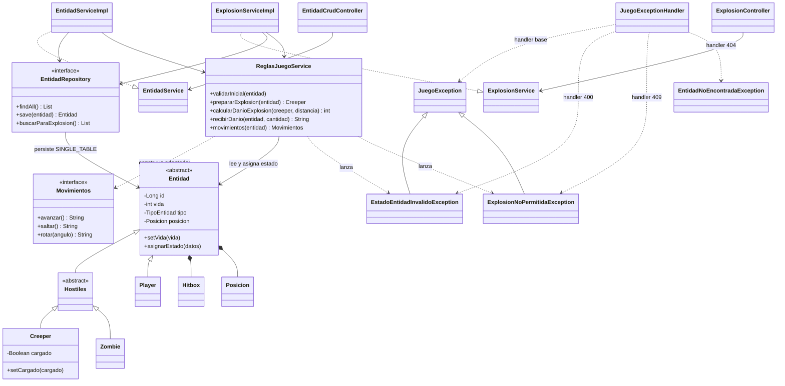

# Taller Git 2026 — Minecraft · POO-09 y base POO-08

## POO-09 — APIs cruzadas

**Escenario:** registrar una operación de detonación coordinada solo si Sofía valida
sus participantes y Nicolás autoriza un explosivo independiente. Se persiste la
**jugada autorizada**, no una explosión ejecutada: no se aplica daño, no se consumen
Creepers y no se llama al escenario de orquestación de los compañeros.

### Estado de entrega y POO-08

- **Corrección POO-08 recibida:** organización en paquetes **2/3**, con descuento por
  validaciones y reglas dentro del dominio. **Observación atendida:** `EntidadServiceImpl`
  valida y construye estados mediante `ReglasJuegoService`; `ExplosionServiceImpl` aplica
  las reglas y excepciones desde la capa service. Entidades y embebidos solo conservan
  estado/mapeo, sin excepciones de negocio ni callbacks de validación. Las demos delegan
  en `DemostracionService`; la integración remota usa las mismas reglas locales de service.
- **Mejora sin descuento atendida:** `domain/Main.java` se movió a
  `src/test/java/py/edu/uc/lp3/demo/Main.java`.
- Evidencia: `ArquitecturaDominioTests`, pruebas de reglas en `src/test/java/py/edu/uc/lp3/service/`
  y regresión REST/JPA. El alumno confirmó que esta era **la única observación de POO-08**;
  queda cerrada en el código y documentada para el criterio de corrección de POO-09.
  Esto no cambia retroactivamente la nota de POO-08 ni se declara que obtuvo 24/24.
- **Pendiente:** confirmar los commits exactos que ejecutan Sofía y Nicolás.
  Los enlaces POO-08 al final son históricos.
- Código, pruebas, colección y documentación POO-09 están versionados en el snapshot
  enlazado más abajo. Falta fijar los commits ajenos para cerrar la entrega reproducible.

### Mapa del grupo (Minecraft)

| Rol en mi entrega | Autor | Base | Documento OpenAPI |
|---|---|---|---|
| A1 | Amir Dujak | `http://100.78.121.31:8080` | http://100.78.121.31:8080/v3/api-docs |
| A2 | Sofía Torres | `http://100.79.75.27:8081` | http://100.79.75.27:8081/v3/api-docs |
| A3 | Nicolás Rodriguez | `http://100.83.179.97:8080` | http://100.83.179.97:8080/v3/api-docs |

Estas son las direcciones compartidas por **Tailscale**: requieren acceso autorizado a
esa red y que los tres servicios estén encendidos; no requieren estar en la misma LAN.
Desde la máquina de Amir también se puede usar `http://localhost:8080`. Cada uno es A1
de su propia entrega; los tres README deben identificar las mismas tres bases.

| Autor | Repositorio | Commit reproducible |
|---|---|---|
| Amir | https://github.com/AmirDujak/adb-taller-git-2026 | [d283f6594c9f727499c71332ae2427d5c8868bf0](https://github.com/AmirDujak/adb-taller-git-2026/commit/d283f6594c9f727499c71332ae2427d5c8868bf0) |
| Sofía | https://github.com/Sofia-torres00/st-taller-git-2026 | Pendiente de confirmar con la autora |
| Nicolás | https://github.com/NicoRodriguez85677/NRodriguez-taller-git-2026 | Pendiente de confirmar con el autor |

Swagger UI: [Amir](http://100.78.121.31:8080/swagger-ui/index.html),
[Sofía](http://100.79.75.27:8081/swagger-ui/index.html),
[Nicolás](http://100.83.179.97:8080/swagger-ui/index.html).
Para confirmar los hashes, cada compañero ejecuta `git rev-parse HEAD` y
`git status --short` en su proyecto. Si hay cambios locales que forman parte del
servicio, debe publicarlos antes de fijar el commit: el último hash de GitHub por sí
solo no demuestra qué versión está corriendo en la notebook.

| Dueño | Dos reglas publicadas | Regla/operación consumida en mi escenario |
|---|---|---|
| Amir | Onda expansiva: daño decreciente hasta radio 3; carga eléctrica: máximo 20 pasa a 40. | Los compañeros pueden consultar mi OpenAPI y `/api/lp3/explosiones/simular`; esta última **modifica** mi H2. |
| Sofía | Participantes distintos de tipos Creeper, jugador y cerdo con Creeper vivo; daño de explosión hasta 20 dentro de radio 6. | `POST /api/explosiones/validar`: consulta las condiciones de los participantes sin daño ni escrituras. |
| Nicolás | Solo detona un Creeper vivo, no detonando ni ya explotado; daño decreciente hasta radio 4. | `GET /api/minecraft/explosivos/{id}`: consulta la capacidad actual de explotar. |

Fuentes: documentos OpenAPI enlazados arriba, leídos antes de implementar los clientes.
No se clonó código ajeno para copiar reglas. Si cambia una ruta hay que actualizar el
cliente según el contrato nuevo; cambiar solo el documento no reconfigura Java.
La validación de Sofía **no** exige objetivos vivos o dentro del radio.

### Arranque de los tres servicios

Requisito JDK 21. Arrancar primero Sofía y Nicolás y después Amir. En notebooks distintas,
cada uno usa su repositorio y ejecuta `./mvnw spring-boot:run` en el puerto acordado.
Para una sola máquina, usar carpetas separadas, bases separadas y puertos diferentes:

1. **Sofía:** clonar `https://github.com/Sofia-torres00/st-taller-git-2026.git` y entrar
   en `st-taller-git-2026`. Seleccionar el hash **pendiente de confirmar** con
   `git switch --detach HASH_SOFIA` y ejecutar
   `./mvnw spring-boot:run -Dspring-boot.run.arguments=--server.port=8081`.
2. **Nicolás:** clonar `https://github.com/NicoRodriguez85677/NRodriguez-taller-git-2026.git`
   y entrar en `NRodriguez-taller-git-2026`. Seleccionar el hash **pendiente de confirmar**
   con `git switch --detach HASH_NICOLAS` y ejecutar
   `./mvnw spring-boot:run -Dspring-boot.run.arguments=--server.port=8082`.
3. **Amir:** clonar `https://github.com/AmirDujak/adb-taller-git-2026.git` y seleccionar
   el snapshot POO-09 con `git switch --detach d283f6594c9f727499c71332ae2427d5c8868bf0`. Ejecutar:

```bash
SOFIA_API_BASE_URL=http://localhost:8081 NICOLAS_API_BASE_URL=http://localhost:8082 ./mvnw spring-boot:run
```

`HASH_SOFIA` y `HASH_NICOLAS` son marcadores, no hashes reales; reemplazarlos antes de
ejecutar esos comandos. El arranque de los commits ajenos aún no fue verificado por
clonación. Actualizar también las tres bases en Insomnia cuando se use el esquema local.
La colección viene configurada para las tres direcciones Tailscale del mapa. No configurar a los compañeros para que
la validación invoque de nuevo este escenario. Sus orquestadores propios no se utilizan.

| Propiedad de A1 | Variable / valor predeterminado |
|---|---|
| `poo09.sofia.base-url` | `SOFIA_API_BASE_URL` / `http://100.79.75.27:8081` |
| `poo09.nicolas.base-url` | `NICOLAS_API_BASE_URL` / `http://100.83.179.97:8080` |
| `poo09.connect-timeout` | `3s` (sobrescribible como propiedad Spring) |
| `poo09.request-timeout` | `10s` por consulta completa |

### Contrato y persistencia

```http
POST /api/lp3/jugadas-cruzadas
Content-Type: application/json

{"creeperSofiaId":"UUID","jugadorSofiaId":"UUID","cerdoSofiaId":"UUID","explosivoNicolasId":"UUID"}
```

Los cuatro valores son UUID reales de sus bases; el ejemplo no se puede enviar literalmente.
Los participantes de Sofía y el explosivo de Nicolás son **independientes**. No se supone
que el mismo ID exista en ambos proveedores. La operación combina las autorizaciones de
los dos explosivos de una operación coordinada, no sincroniza mundos ni ejecuta detonaciones.

1. Sofía valida primero para descartar participantes inválidos antes de consultar el
   segundo explosivo. El cliente comprueba `aceptada=true` y los tres IDs devueltos.
2. Nicolás debe devolver el ID solicitado y `puedeExplotar=true`. HTTP 200 por sí solo no basta.
3. Solo entonces comienza una transacción local y se inserta `jugadas_cruzadas`: ID Long,
   fecha UTC, cuatro UUID y las dos aprobaciones. No hay escrituras durante las consultas.

El éxito devuelve **201**, la jugada y `Location`. `GET /api/lp3/jugadas-cruzadas` lista
en orden de ID; `GET /api/lp3/jugadas-cruzadas/{id}` permite recuperarla, incluso tras
reiniciar con la H2 en archivo. El GET no necesita que los compañeros estén conectados.

Errores: **400** entrada propia inválida; **409** rechazo remoto (incluidos 400/409 del
compañero y booleanos falsos); **404** participante remoto inexistente; **502** fallo de
conexión, HTTP inesperado o contrato inválido; **504** timeout. Los errores remotos incluyen
`codigo`, `proveedor` (`A2_SOFIA` / `A3_NICOLAS`) y `error`. Se traduce el error, conservando
cuando existe su mensaje público `error` (limitado a 500 caracteres), no el cuerpo completo.

Rechazos y fallos técnicos no guardan jugadas ni auditorías en H2, ni modifican entidades.
Un fallo durante el INSERT revierte la transacción. No hay transacción distribuida,
reintentos automáticos ni reservas: las aprobaciones describen el estado consultado.
Repetir un éxito **crea otra jugada**, no hay clave de idempotencia.

### Insomnia y verificación

Importar [`insomnia/poo09.yaml`](insomnia/poo09.yaml). Recorrer carpetas **01 → 02 → 03 → 04**,
una iteración, secuencialmente. No detener por los 409 esperados.

- **01:** lee los tres OpenAPI y crea datos nuevos de prueba en los compañeros, con IDs
  capturados automáticamente: Creeper vivo y muerto, jugador, cerdo, Creeper de Nicolás
  y Zombie no explosivo. **Esta preparación sí escribe en las bases remotas**; usar bases
  de desarrollo acordadas. Repetirla crea más entidades; no borra datos ajenos.
- **02:** registra el escenario feliz, recupera la jugada y verifica un registro adicional.
- **03:** Creeper muerto provoca rechazo de Sofía; compara la lista completa antes/después.
- **04:** Sofía acepta pero el Zombie de Nicolás provoca rechazo; compara la lista completa.
- Para comprobar persistencia, reiniciar A1 y repetir **solo** «Recuperar jugada».

Las respuestas reales de una verificación sin escrituras remotas quedan en
[`insomnia/poo09-respuestas-reales.json`](insomnia/poo09-respuestas-reales.json).
Son evidencia HTTP, no una afirmación de haber ejecutado la interfaz gráfica de Insomnia.
Si un compañero no responde: comprobar red/URL, avisar al autor y repetir manualmente solo
cuando esté disponible. No declarar éxito con mocks ni guardar una jugada ante timeout.

```bash
./mvnw test
node --test insomnia/tests/*.test.cjs
```

Las pruebas Java cubren aprobación, rechazo atribuido de ambos, booleano falso, contrato
inválido, HTTP inesperado, timeouts, entrada inválida, rollback y persistencia tras reabrir H2.
No usan `./data/entidades`. El documento para Classroom está en
[`docs/ESPECIFICACIONES-POO09.md`](docs/ESPECIFICACIONES-POO09.md).

**Commit de implementación POO-09 para compartir con el grupo:**
https://github.com/AmirDujak/adb-taller-git-2026/commit/d283f6594c9f727499c71332ae2427d5c8868bf0

Incluye corrección POO-08, OpenAPI, clientes, escenario, pruebas, colección, bitácora
y especificaciones. El commit posterior solo fija este enlace; el snapshot enlazado
conserva los pendientes documentales de ese momento. No usar el enlace histórico
POO-08 como entrega de este challenge. Al recibir los hashes ajenos se actualizará
la documentación y se podrá fijar un nuevo commit de entrega definitiva.
Consigna: [POO-09](https://github.com/alefq/afq-taller-git-2024/blob/main/docs/ejercicio-poo-09-apis-cruzadas-2026-11-16.md).

---

## Base POO-08 y funcionalidades anteriores

**Alumno:** Amir Dujak · Trabajo individual · [Repositorio](https://github.com/AmirDujak/adb-taller-git-2026)

API REST con Spring Boot, Java 21, Spring Data JPA y H2. Persiste la jerarquía real
de `Entidad`, permite CRUD y aplica explosiones sobre `Creeper`, `Player` y `Zombie`.
No usa una lista en el controller ni una copia paralela del dominio para guardar vidas.

## Arranque y pruebas

Requisitos: JDK 21, conexión para descargar dependencias en el primer arranque y puerto 8080 libre.
Se conserva Spring Boot **4.1.1** del proyecto original.

```bash
./mvnw spring-boot:run
```

Servicio: `http://localhost:8080`. `GET /` confirma que está vivo. Detener con Ctrl+C.

```bash
./mvnw test
```

Las pruebas habituales usan H2 en memoria. Otra prueba abre, cierra y vuelve a abrir
una H2 **en archivo temporal** para verificar que las vidas y los subtipos sobreviven
al reinicio. Ninguna prueba usa ni borra `./data/entidades`.

## OpenAPI y Swagger UI

Con la aplicación iniciada mediante `./mvnw spring-boot:run`:

- **Swagger UI:** http://localhost:8080/swagger-ui.html
- **OpenAPI JSON:** http://localhost:8080/v3/api-docs
- **OpenAPI YAML:** http://localhost:8080/v3/api-docs.yaml

Se usa `springdoc-openapi-starter-webmvc-ui` 3.2.0 para Spring Boot 4.
La documentación incluye todos los endpoints de inicio, CRUD, movimientos,
demostraciones y explosiones, junto con las rutas de compatibilidad, parámetros,
ejemplos de entrada, esquemas y respuestas HTTP. `ObjetoService` consume una API
externa y no expone un endpoint propio.

**Atención:** crear, actualizar, eliminar o ejecutar `/api/lp3/explosiones/simular` desde
Swagger UI modifica los datos reales de H2; simular una explosión también elimina entidades.
La operación `previsualizar-integrada` es de solo lectura, aunque usa POST.
La operación `aplicar-integrada` sí actualiza la salud en el proyecto remoto.
En producción, proteger estas rutas o deshabilitar la documentación con
`springdoc.api-docs.enabled=false` y `springdoc.swagger-ui.enabled=false`.

`OpenApiIntegrationTests` verifica la cobertura de los controladores y sus alias,
los esquemas, los códigos de respuesta y el acceso a Swagger UI y OpenAPI.

### Explosión integrada con el proyecto remoto

`POST /api/lp3/explosiones/previsualizar-integrada` combina un Creeper persistido
en este proyecto con un jugador y un cerdo del proyecto remoto documentado en
http://10.40.142.72:8081/swagger-ui/index.html.

```bash
curl -X POST http://localhost:8080/api/lp3/explosiones/previsualizar-integrada \
  -H 'Content-Type: application/json' \
  -d '{"creeperId":1,"jugadorExternoId":"22222222-2222-4222-8222-222222222222","cerdoExternoId":"33333333-3333-4333-8333-333333333333"}'
```

Reemplazar los IDs de ejemplo por identificadores existentes: `creeperId` es un
`Long` **local**; los otros dos son UUID **remotos**, distintos y de tipos `JUGADOR`
y `CERDO`, respectivamente. El Creeper debe estar vivo y tener posición guardada.
Las coordenadas de los dos proyectos se interpretan como pertenecientes al mismo
mundo y con la misma unidad de medida; no se realiza una transformación espacial.

La integración reutiliza `EntidadService.buscar()` y `ReglasJuegoService` para preparar
la explosión, calcular distancias y daño. Las entidades no ejecutan esas reglas. Del proyecto remoto
adopta la validación de tipos de los participantes y sus UUID distintos, y consulta
sus datos mediante **WebClient**, usando únicamente `GET /api/entidades/{id}`.
No llama a `/api/explosiones`, no consume al Creeper, no actualiza salud ni elimina
entidades en ninguno de los proyectos. No mantiene una transacción de H2 abierta
mientras espera al servidor remoto.

La respuesta declara `reglasAplicadas: "LOCALES"`: radio de **3 bloques**, daño
máximo 20 (**40 si está cargado**), reducción lineal redondeada al entero más cercano
y daño cero en el borde o fuera del radio. No se usa el radio de 6 del proyecto
remoto ni se asume su fórmula de daño. `danioAplicado` no supera la salud remota;
`saludEstimada` conserva los decimales y se limita como mínimo a cero. La vida
remota se consulta en ese momento; el resultado es una estimación, no una reserva
ni una operación atómica entre servidores.

Configuración en `src/main/resources/application.properties`:

| Propiedad | Valor por defecto |
|---|---|
| `minecraft-api.base-url` | `http://10.40.142.72:8081` (sobrescribible con `MINECRAFT_API_BASE_URL`) |
| `minecraft-api.connect-timeout` | `3s` |
| `minecraft-api.request-timeout` | `10s` por consulta remota |

Se necesita acceso de red al servidor remoto. Las pruebas usan un servidor HTTP
local simulado y H2 en memoria, no dependen de esa dirección ni modifican ese proyecto.

Respuestas: **400** cuerpo/UUID/tipos inválidos; **404** participante local o remoto
inexistente; **409** origen local no apto para explotar; **502** fallo de conexión,
error HTTP del proveedor o datos remotos inválidos; **504** tiempo de espera remoto
agotado. Los errores incluyen `codigo` y `error`, sin exponer el cuerpo interno del proveedor.

### Aplicar daño real en el proyecto remoto

`POST /api/lp3/explosiones/aplicar-integrada` acepta el mismo cuerpo que la
previsualización, pero **modifica la salud persistida del jugador y del cerdo remotos**.
Ejemplo con los participantes creados durante la integración (verificar que sigan existiendo):

```bash
curl -X POST http://localhost:8080/api/lp3/explosiones/aplicar-integrada \
  -H 'Content-Type: application/json' \
  -d '{"creeperId":25,"jugadorExternoId":"2735f321-8b2e-4475-9f59-d503381df2fe","cerdoExternoId":"8f158269-ade3-40eb-8b81-c722c125a366"}'
```

Reemplazar `25` por un Creeper local existente, vivo y con posición. La operación
vuelve a consultar la salud actual: no utiliza una previsualización anterior.
Primero valida **ambos** participantes; después envía un `PUT /api/entidades/{uuid}`
por cada entidad que reciba daño, con nombre, tipo, ubicación originales y salud nueva.
Omite `atributos`: el contrato remoto conserva los que no se informan. La salud se
limita a cero sin eliminar entidades. El Creeper local **no se consume ni se modifica**.

Con el Creeper en `(0,64,0)`, un cerdo en `(2,64,0)` y salud actual 10, el daño local
es 7 y un PUT confirmado guarda salud **3**; entonces Swagger remoto también debe
mostrar 3. Se valida que la respuesta del PUT corresponda al UUID, tipo y salud esperados.

Resultados:

- **200** y `completa: true`: todos confirmados o sin daño que aplicar.
- **207** y `completa: false`: aplicación incompleta o incierta; se devuelve el resultado
  de cada participante sin ocultar las escrituras que ya se confirmaron.
- `CONFIRMADO`: el PUT devolvió la salud esperada, indicada en `saludConfirmada`.
- `SIN_CAMBIOS`: no se envió PUT porque el daño efectivo era cero; se informa la salud consultada.
- `NO_CONFIRMADO`: error, timeout o respuesta inválida del PUT; `saludConfirmada` es null.
- `NO_INTENTADO`: no se envió PUT tras fallar una escritura anterior.

**No hay transacción distribuida ni rollback:** puede actualizarse el jugador y
fallar el cerdo. Se detienen las escrituras restantes tras un fallo y no se reintenta
automáticamente (también se desactiva el reintento de conexión de Reactor Netty).
Un timeout puede ocurrir después de que el servidor haya guardado el cambio: comprobar
el estado remoto antes de repetir. **Cada nueva petición puede causar daño otra vez**;
este endpoint no implementa una clave de idempotencia. Sin ETag/control de versión
en la API remota, una actualización concurrente entre GET y PUT puede sobrescribirse;
evitar operaciones simultáneas sobre los mismos participantes.

Los errores de validación o consulta **anteriores al primer PUT** conservan los
códigos 400/404/409/502/504 descritos arriba y no realizan escrituras.
Las pruebas usan un servidor local simulado para verificar persistencia remota,
conservación de datos, fallos parciales, timeouts, repetición y ausencia de daño local.

## Paquetes y capas

Se sigue la organización del [template LP3](https://github.com/alefq/lp3-template-tp),
no sus versiones antiguas de dependencias; se usa `jakarta.persistence`.

```text
py.edu.uc.lp3
├── Application.java
├── constants/       rutas
├── domain/          Entidad, Creeper, Player, Zombie, Movimientos, Hitbox, Posicion…
├── exceptions/      familia de errores del juego
├── repository/      EntidadRepository (interfaz Spring Data)
├── rest/controller/ CRUD, explosiones, demos y advice HTTP
├── rest/dto/        datos JSON de entrada y resultado de explosión
└── service/impl/    coordinación transaccional y acceso al repositorio
```

El controller depende del contrato `EntidadService`/`ExplosionService`; la implementación
recibe `EntidadRepository` por constructor. Las validaciones, reglas numéricas y sus
excepciones viven exclusivamente en **service**, compartidas en `ReglasJuegoService`.
Las entidades contienen estado, accesores y mapeo JPA. No hay validación de negocio
en constructores o callbacks. El service coordina consultas, mensajes y transacciones.
`DemostracionService` mantiene las demos; `ReglasJuegoService` ofrece un adaptador
`Movimientos` para las descripciones sin trasladar reglas a la Entity.

## H2: propiedades y consola

Configuración en `src/main/resources/application.properties`:

| Propiedad | Qué hace |
|---|---|
| `spring.application.name=adb-taller-git-2026` | Identifica la aplicación en Spring. |
| `spring.datasource.url=jdbc:h2:file:./data/entidades` | Abre una H2 en archivo relativo a la raíz desde la que se ejecuta Maven; conserva datos entre arranques. |
| `spring.datasource.username=sa` | Usuario local de la base. |
| `spring.datasource.password=` | Contraseña vacía solo para desarrollo. |
| `spring.jpa.hibernate.ddl-auto=update` | Crea el esquema faltante y lo actualiza sin recrearlo en cada arranque; no reemplaza migraciones de producción. |
| `spring.jpa.open-in-view=false` | Evita consultas fuera del service; las listas necesarias se inicializan dentro de la transacción. |
| `spring.h2.console.enabled=true` | Habilita la consola de desarrollo; no se debe exponer en producción. |
| `spring.h2.console.path=/h2-console` | Publica la consola en esa ruta. |

Con el servicio activo, abrir `http://localhost:8080/h2-console`, usar la misma URL JDBC,
usuario `sa` y contraseña vacía. Para ver el estado:

```sql
SELECT id, nombre, tipo, vida, cargado, posicion_x, posicion_y, posicion_z
FROM entidades ORDER BY id;
```

También existen `entidad_sonidos` y `entidad_drops`: son colecciones de valores, no
clases hijas del modelo. `data/` y `target/` están fuera de Git.

### Compatibilidad con la base anterior

Se conservan tabla, IDs, vidas, sonidos, drops y posiciones existentes. Antes de
actualizar, respaldar `data/` con el servicio detenido. **No hay que borrar la base.**
Hibernate agrega las columnas que faltan. `@DiscriminatorFormula` toma `tipo` cuando
existe; para filas antiguas con tipo nulo usa el nombre conocido, o `OTRA`.
Así, incluso una fila anterior de Creeper se hidrata como `Creeper`, no como un DTO.
Una actualización guarda su tipo explícito. No se inventan posiciones: asignarlas con PUT.
Las nuevas propiedades específicas que antes no se guardaban tienen valores iniciales
de desarrollo (por ejemplo, hostilidad y arco verdaderos, profesión Granjero, aggro 16).
La prueba `BaseExistenteIntegrationTests` verifica la actualización del esquema antiguo.

## URLs y contrato REST

| Método | URL | Resultado |
|---|---|---|
| GET | `/` | 200, servicio vivo |
| POST | `/api/lp3/entidades` | 201, recurso con ID y cabecera `Location` |
| GET | `/api/lp3/entidades` | 200, colección persistida; inicialmente `[]` |
| GET | `/api/lp3/entidades/{id}` | 200 o 404 |
| PUT | `/api/lp3/entidades/{id}` | 200, actualización persistida, o 400/404 |
| DELETE | `/api/lp3/entidades/{id}` | 204 sin cuerpo, o 404 |
| GET | `/api/lp3/entidades/movimientos` | 200, mensajes de la interfaz `Movimientos` |
| POST | `/api/lp3/explosiones/simular` | 200 con resultado persistido, o 400/404/409 |

`/api/entidades` sigue siendo alias del CRUD y de movimientos; `Location` usa la ruta principal.

Ejemplo de POST; copiar el ID de la respuesta, no asumir que será 1:

```bash
curl -i http://localhost:8080/api/lp3/entidades \
  -H 'Content-Type: application/json' \
  -d '{"nombre":"Mi Creeper","tipo":"CREEPER","cargado":false,"vida":20,
       "danoBase":0,"velocidadMovimiento":0.8,
       "hitbox":{"ancho":0.6,"alto":1.7,"profundidad":0.6},
       "sonidos":["siseo"],"drop":["polvora"],"posicion":{"x":0,"y":64,"z":0}}'
```

### Invariantes y actualización

- Nombre no vacío de hasta 255 caracteres, vida inicial positiva, daño base no negativo.
- Velocidad finita no negativa; hitbox con tres dimensiones finitas positivas.
- Sonidos y drops obligatorios, aunque pueden ser `[]`; sus textos no pueden ser nulos,
  vacíos ni superar 255 caracteres. Los getters devuelven copias no modificables.
- Posición opcional; si se envía, requiere las tres coordenadas finitas.
- Solo un Creeper puede estar cargado. El subtipo no se cambia por PUT.
- El servicio de reglas aplica daño sin vida negativa e impide el movimiento de entidades muertas.
- El service valida antes de crear/actualizar; las entidades exponen asignación de estado
  para JPA y servicios, sin reglas ni excepciones propias. No hay callbacks de negocio.
  Las restricciones SQL `CHECK` siguen como integridad de almacenamiento, no reemplazan al service.

En POST son obligatorios los campos comunes del ejemplo; `tipo` puede omitirse por
compatibilidad: se deduce del nombre conocido o queda `OTRA`. La carga predeterminada
es falsa y la posición queda ausente. Es preferible enviar siempre `tipo`.

PUT reemplaza todos los campos comunes y exige su presencia. **Excepción de compatibilidad:**
`tipo`, `cargado` y `posicion` omitidos o nulos conservan el valor anterior. No permite
borrar una posición mediante null ni transformar un Zombie en Creeper. No hay PATCH.
Los atributos específicos de las demos que no figuran en `EntidadDatos` no se editan por este CRUD.

## Dos reglas del juego y simulación

1. **Onda expansiva:** `ReglasJuegoService.calcularDanioExplosion` calcula daño para `Player`, `Zombie` y otras entidades según su distancia tridimensional, sin daño desde el borde de 3 bloques.
2. **Carga eléctrica:** un `Creeper` cargado duplica el daño de esa misma onda; al consumirse la explosión desaparece el origen y se eliminan los objetivos cuya vida llega a cero.

Son reglas propias del práctico, no una réplica exacta del juego: el máximo normal es
20, cargado 40; para `distancia < 3`, daño = `round(maximo * (1 - distancia / 3))`.
`ReglasJuegoService.recibirDanio` limita la pérdida a la vida disponible. No hay explosiones en cadena.
Se omiten objetivos sin posición o fuera del radio; los del borde reciben cero.

Crear primero un Creeper en `(0,64,0)`, un Player de vida 20 en `(1,64,0)` y un Zombie
de vida 5 en `(2,64,0)`. Enviar el ID real del Creeper:

```http
POST /api/lp3/explosiones/simular
Content-Type: application/json

{"creeperId": 123}
```

El Player pierde 13 y queda en **7**; el Zombie pierde sus 5 y se elimina; el Creeper
también se elimina. GET muestra esos resultados en H2. Un segundo POST con el mismo
Creeper devuelve 404. En el escenario cargado de Insomnia, un Player de vida 100 situado
en el origen queda en **60**. La respuesta informa radio, origen consumido y objetivos
con distancia, vida inicial, daño real, vida final y si fueron eliminados.

La operación bloquea las filas en orden de ID y es transaccional: daño y bajas se
confirman juntos o se revierten juntos. El nombre histórico `simular` **no significa
vista previa**: el POST modifica H2. No se guarda un historial adicional de explosiones;
lo persistido es el estado resultante del mundo.

## Excepciones y respuestas

`JuegoException extends RuntimeException` es la base no comprobada; el advice tiene
un handler por tipo. Las hijas las lanza exclusivamente la capa service, no el dominio ni el controller.

| Tipo | HTTP | `codigo` | Ejemplo |
|---|---|---|---|
| `EstadoEntidadInvalidoException` | 400 | `ESTADO_ENTIDAD_INVALIDO` | Vida inicial 0 o Player cargado |
| `ExplosionNoPermitidaException` | 409 | `EXPLOSION_NO_PERMITIDA` | Player como origen o Creeper sin posición |
| `JuegoException` | 422 | `REGLA_JUEGO` | Respaldo para otras reglas; no se inventa un endpoint para forzar la base |
| `EntidadNoEncontradaException` | 404 | `ENTIDAD_NO_ENCONTRADA` | ID ausente, distinto de una regla incumplida |
| Cuerpo JSON ilegible | 400 | `JSON_INVALIDO` | Tipo desconocido, JSON roto o cuerpo ausente |

```json
{"codigo":"EXPLOSION_NO_PERMITIDA","error":"La entidad indicada no es un Creeper"}
```

409 indica conflicto con el estado/tipo actual del objeto, no un fallo del servidor.
Las excepciones no comprobadas evitan obligar a todas las capas a declarar `throws`
y Spring revierte por defecto la transacción ante ellas. Una excepción comprobada
obligaría a capturarla/declararla y requeriría revisar la configuración de rollback.

## Qué hay que pensar — respuestas del modelo

1. **Recurso y verbo:** el sustantivo es `entidades`; la URL identifica la colección/ítem y el verbo expresa CRUD. La ruta histórica de simulación representa la operación sobre explosiones.
2. **Identidad:** `Long id` es clave generada por H2 con `IDENTITY`; el JSON de creación la omite y las actualizaciones toman el ID de la URL.
3. **Herencia y tablas:** elegí `SINGLE_TABLE` porque los mobs comparten casi todos los atributos y la explosión consulta toda la familia; evita joins por objetivo, a cambio de columnas específicas anulables. La fórmula de Hibernate mantiene compatibilidad con tipos antiguos nulos.
4. **Subtipo JSON:** Jackson lee `tipo` en `EntidadDatos` y lo escribe mediante `getTipo`; una fábrica explícita construye el subtipo real. No uso nombres Java arbitrarios ni tipado global de Jackson: el enum limita las clases admitidas.
5. **Interfaz y repositorio:** Spring Data implementa `EntidadRepository`; el service depende de ese contrato y el controller del contrato del service, no de SQL ni de una implementación H2. Como en POO-07, el cliente conoce mensajes, no cómo se cumplen.
6. **Protocolo:** `GET /api/lp3/entidades/movimientos` delega al service; un adaptador `Movimientos` describe avanzar/saltar sin cambiar posiciones ni vidas. La Entity ya no implementa acciones de negocio.
7. **Validaciones:** `ReglasJuegoService` valida datos antes de asignarlos a `Entidad`, `Hitbox` y `Posicion`. En Insomnia, pedidos 03/06 → 07 → 08 muestran que el POST ilegal no agrega filas. No hay validación de negocio en callbacks JPA.
8. **PUT/PATCH:** PUT exige los campos comunes; solo las tres extensiones opcionales conservan lo anterior si se omiten. Esta compatibilidad está documentada y probada. PATCH no está implementado.
9. **DELETE:** retirar del mundo llama `retirarDelMundo` y elimina físicamente el registro y sus colecciones; devuelve 204. No representa daño ni entrega inventario a otro jugador.
10. **Dos reglas:** la onda aplica daño a varios objetivos; la carga duplica esas pérdidas. La explosión consume el Creeper, elimina muertos y persiste supervivientes; GET muestra el resultado.
11. **Excepciones:** construcción ilegal y explosión imposible son hijas distintas de `JuegoException`; un ID inexistente usa otro tipo y 404. El JSON ofrece `codigo` estable y `error` legible.
12. **Cambiar H2:** cambiarían driver, URL, credenciales y migraciones; hay que revisar los defaults SQL y la compatibilidad de la fórmula. Controller, reglas, DTO y contrato del repositorio no deberían cambiar.

## Diagrama Mermaid



Flecha sólida con triángulo: **herencia**; línea discontinua con triángulo:
**implementación de interfaz**; flecha normal: **uso/dependencia**; rombo:
**composición**. Las dos excepciones heredan de la misma base, no una de la otra.
El diagrama enfoca las tres clases de la simulación; los demás mobs anteriores permanecen.

## Demos anteriores y corrección de responsabilidades

Para atender la observación POO-08, `comportamiento`, daño, movimiento y disparo se
ejecutan ahora en servicios, no en métodos de las entidades. La herencia JPA se mantiene;
no se presenta la versión anterior con reglas polimórficas en Entities como arquitectura actual.

`Player()` y `Player(vida,danoBase,velocidad)`, así como los constructores de Zombie,
son **sobrecarga**: mismo nombre, parámetros diferentes. Las variantes de disparo ahora
son `ReglasJuegoService.disparar(esqueleto)` y `disparar(esqueleto, distancia)`. JPA usa constructores
sin argumentos públicos/protegidos; solo `Entidad()` protegido se reserva para hidratación.
La validación de esos datos corresponde a los servicios, no a los constructores.

Se conservan las demos GET temporales (no son el CRUD ni guardan sus acciones):
`/entidad/{tipo}`, `/entidades/zombie`, `/entidades/esqueleto/disparar`,
`/entidades/comportamientos` y `/entidades`.

## Importar y recorrer Insomnia

1. En Insomnia, **Import → File**, seleccionar [`insomnia/minecraft.yaml`](insomnia/minecraft.yaml).
   Si ya se importó una versión anterior, volver a importar y usar la colección cuyo
   nombre termina en **IDs automáticos (corregido)**; editar el archivo no actualiza la copia anterior en Insomnia.
2. Revisar **Base Environment**: `base_url` es `http://localhost:8080`. Los scripts
   de los siete POST válidos capturan el ID y actualizan el entorno automáticamente;
   **no hay que copiar IDs**. Los valores 0 son solo el estado inicial del export.
   Usar el entorno base importado, sin sobrescribir los IDs en variables de carpeta.
3. Recorrer **01 — Estado y CRUD** (pedidos 01–11): alta, lectura, PUT, POST ilegal,
   comprobación sin basura, DELETE y 404.
4. Recorrer **02 — Explosión normal** (12–19): crear las tres entidades, ejecutar movimientos,
   simular y comprobar Player en 7, Zombie y Creeper ausentes.
5. Detener y arrancar de nuevo; repetir el GET 17: la vida debe seguir en 7.
6. Recorrer **03 — Carga** (20–23): Creeper cargado y Player de 100 en la misma posición;
   simular y verificar 60 en el GET.
7. Recorrer **04 — Excepciones** (24–28): ver códigos diferentes 400/409, crear el Creeper
   sin posición y confirmar que los errores no dañaron los registros existentes.

Se pueden ejecutar las carpetas completas con **Run**, en orden 01 → 02 → 03 → 04,
una iteración y secuencialmente (no en paralelo). No detener la corrida por el solo
hecho de recibir 400/404/409: varios pedidos buscan esos errores deliberadamente.
Para comprobar el reinicio, después de la carpeta 02 reiniciar el servicio y enviar
**solo el GET 17**, sin volver a crear las entidades.

Cada alta limpia su variable antes de enviar el POST y solo guarda un ID entero
positivo si recibe 201; de lo contrario el script informa un error y deja 0 para no
reutilizar silenciosamente un ID antiguo. Los POST ilegales y las simulaciones no
sobrescriben esas variables. Los scripts usan la API documentada de Insomnia:
`insomnia.response.code`, `insomnia.response.json()` e `insomnia.environment.set()`.
El código HTTP numérico está en `code`; `status` es una frase textual (por ejemplo,
`"Created"`) y no debe compararse con 201. Las pruebas reproducen esa distinción.

Ejecutar una vez cada simulación por Creeper; para repetir, volver a ejecutar la
carpeta del escenario desde sus altas: los IDs se reemplazan automáticamente.
La colección es destructiva sobre las entidades del escenario y puede afectar otros
objetivos cercanos: usar una base de desarrollo, no datos importantes. Las coordenadas
de ambos escenarios están separadas. El export antiguo en la raíz se conserva como
historial, pero **la colección de entrega es `insomnia/minecraft.yaml`**.

Pruebas de los scripts (opcional, requiere Node.js y Ruby con sus bibliotecas estándar):

```bash
node --test insomnia/tests/automatic-ids.test.cjs
```

Se ejecutan los scripts reales del YAML con respuestas simuladas: captura de las
siete variables, reemplazo de IDs anteriores y rechazo de respuestas/IDs inválidos.
Incluyen respuestas 201 con `status` textual o vacío, como las que expone Insomnia.

## Entrega histórica POO-08

- [Especificaciones para adjuntar en Classroom](docs/ESPECIFICACIONES-POO08.md).
- [Bitácora de asistencia IA](BITACORA.md), con agente, modelo exacto y prompts.
- [Enunciado](https://github.com/alefq/afq-taller-git-2024/blob/main/docs/ejercicio-poo-08-crud-h2-insomnia-2026-10-28.md)
  y [rúbrica](https://github.com/alefq/afq-taller-git-2024/blob/main/docs/RUBRICA-ejercicios-lp3-2026.md).
- Licencia: [Apache 2.0](LICENSE).

**Commit histórico de POO-08 (no es la entrega POO-09):**
https://github.com/AmirDujak/adb-taller-git-2026/commit/8fb53f29c950ac7e47357b2c17c8cc31544257df

El commit posterior solo fija este enlace en la documentación; el snapshot enlazado
ya incluye código, pruebas, colección con IDs automáticos y especificaciones. Para Classroom, adjuntar
la versión de las especificaciones que contiene este enlace.
