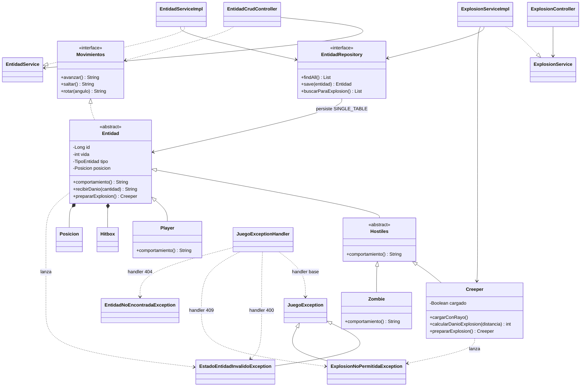

# Taller Git 2026 — Minecraft · POO-08

**Alumno:** Amir Dujak · Trabajo individual · [Repositorio](https://github.com/AmirDujak/adb-taller-git-2026)

API REST con Spring Boot, Java 21, Spring Data JPA y H2. Persiste la jerarquía real
de `Entidad`, permite CRUD y aplica explosiones sobre `Creeper`, `Player` y `Zombie`.
No usa una lista en el controller ni una copia paralela del dominio para guardar vidas.

## Arranque y pruebas

Requisitos: JDK 21, conexión para descargar dependencias en el primer arranque y puerto 8080 libre.
Se conserva Spring Boot **4.1.1** del proyecto original.

```bash
./mvnw spring-boot:run
```

Servicio: `http://localhost:8080`. `GET /` confirma que está vivo. Detener con Ctrl+C.

```bash
./mvnw test
```

Las pruebas habituales usan H2 en memoria. Otra prueba abre, cierra y vuelve a abrir
una H2 **en archivo temporal** para verificar que las vidas y los subtipos sobreviven
al reinicio. Ninguna prueba usa ni borra `./data/entidades`.

## Paquetes y capas

Se sigue la organización del [template LP3](https://github.com/alefq/lp3-template-tp),
no sus versiones antiguas de dependencias; se usa `jakarta.persistence`.

```text
py.edu.uc.lp3
├── Application.java
├── constants/       rutas
├── domain/          Entidad, Creeper, Player, Zombie, Movimientos, Hitbox, Posicion…
├── exceptions/      familia de errores del juego
├── repository/      EntidadRepository (interfaz Spring Data)
├── rest/controller/ CRUD, explosiones, demos y advice HTTP
├── rest/dto/        datos JSON de entrada y resultado de explosión
└── service/impl/    coordinación transaccional y acceso al repositorio
```

El controller depende del contrato `EntidadService`/`ExplosionService`; la implementación
recibe `EntidadRepository` por constructor. Las reglas numéricas viven en el dominio.
El service coordina consultas, mensajes del juego y guardado dentro de una transacción.

## H2: propiedades y consola

Configuración en `src/main/resources/application.properties`:

| Propiedad | Qué hace |
|---|---|
| `spring.application.name=adb-taller-git-2026` | Identifica la aplicación en Spring. |
| `spring.datasource.url=jdbc:h2:file:./data/entidades` | Abre una H2 en archivo relativo a la raíz desde la que se ejecuta Maven; conserva datos entre arranques. |
| `spring.datasource.username=sa` | Usuario local de la base. |
| `spring.datasource.password=` | Contraseña vacía solo para desarrollo. |
| `spring.jpa.hibernate.ddl-auto=update` | Crea el esquema faltante y lo actualiza sin recrearlo en cada arranque; no reemplaza migraciones de producción. |
| `spring.jpa.open-in-view=false` | Evita consultas fuera del service; las listas necesarias se inicializan dentro de la transacción. |
| `spring.h2.console.enabled=true` | Habilita la consola de desarrollo; no se debe exponer en producción. |
| `spring.h2.console.path=/h2-console` | Publica la consola en esa ruta. |

Con el servicio activo, abrir `http://localhost:8080/h2-console`, usar la misma URL JDBC,
usuario `sa` y contraseña vacía. Para ver el estado:

```sql
SELECT id, nombre, tipo, vida, cargado, posicion_x, posicion_y, posicion_z
FROM entidades ORDER BY id;
```

También existen `entidad_sonidos` y `entidad_drops`: son colecciones de valores, no
clases hijas del modelo. `data/` y `target/` están fuera de Git.

### Compatibilidad con la base anterior

Se conservan tabla, IDs, vidas, sonidos, drops y posiciones existentes. Antes de
actualizar, respaldar `data/` con el servicio detenido. **No hay que borrar la base.**
Hibernate agrega las columnas que faltan. `@DiscriminatorFormula` toma `tipo` cuando
existe; para filas antiguas con tipo nulo usa el nombre conocido, o `OTRA`.
Así, incluso una fila anterior de Creeper se hidrata como `Creeper`, no como un DTO.
Una actualización guarda su tipo explícito. No se inventan posiciones: asignarlas con PUT.
Las nuevas propiedades específicas que antes no se guardaban tienen valores iniciales
de desarrollo (por ejemplo, hostilidad y arco verdaderos, profesión Granjero, aggro 16).
La prueba `BaseExistenteIntegrationTests` verifica la actualización del esquema antiguo.

## URLs y contrato REST

| Método | URL | Resultado |
|---|---|---|
| GET | `/` | 200, servicio vivo |
| POST | `/api/lp3/entidades` | 201, recurso con ID y cabecera `Location` |
| GET | `/api/lp3/entidades` | 200, colección persistida; inicialmente `[]` |
| GET | `/api/lp3/entidades/{id}` | 200 o 404 |
| PUT | `/api/lp3/entidades/{id}` | 200, actualización persistida, o 400/404 |
| DELETE | `/api/lp3/entidades/{id}` | 204 sin cuerpo, o 404 |
| GET | `/api/lp3/entidades/movimientos` | 200, mensajes de la interfaz `Movimientos` |
| POST | `/api/lp3/explosiones/simular` | 200 con resultado persistido, o 400/404/409 |

`/api/entidades` sigue siendo alias del CRUD y de movimientos; `Location` usa la ruta principal.

Ejemplo de POST; copiar el ID de la respuesta, no asumir que será 1:

```bash
curl -i http://localhost:8080/api/lp3/entidades \
  -H 'Content-Type: application/json' \
  -d '{"nombre":"Mi Creeper","tipo":"CREEPER","cargado":false,"vida":20,
       "danoBase":0,"velocidadMovimiento":0.8,
       "hitbox":{"ancho":0.6,"alto":1.7,"profundidad":0.6},
       "sonidos":["siseo"],"drop":["polvora"],"posicion":{"x":0,"y":64,"z":0}}'
```

### Invariantes y actualización

- Nombre no vacío de hasta 255 caracteres, vida inicial positiva, daño base no negativo.
- Velocidad finita no negativa; hitbox con tres dimensiones finitas positivas.
- Sonidos y drops obligatorios, aunque pueden ser `[]`; sus textos no pueden ser nulos,
  vacíos ni superar 255 caracteres. Los getters devuelven copias no modificables.
- Posición opcional; si se envía, requiere las tres coordenadas finitas.
- Solo un Creeper puede estar cargado. El subtipo no se cambia por PUT.
- La vida solo baja mediante `recibirDanio`, nunca queda negativa y una entidad muerta no se mueve.
- No hay setters públicos. Constructores/fábrica, actualización y callbacks JPA validan;
  el esquema nuevo también tiene restricciones numéricas `CHECK`.

En POST son obligatorios los campos comunes del ejemplo; `tipo` puede omitirse por
compatibilidad: se deduce del nombre conocido o queda `OTRA`. La carga predeterminada
es falsa y la posición queda ausente. Es preferible enviar siempre `tipo`.

PUT reemplaza todos los campos comunes y exige su presencia. **Excepción de compatibilidad:**
`tipo`, `cargado` y `posicion` omitidos o nulos conservan el valor anterior. No permite
borrar una posición mediante null ni transformar un Zombie en Creeper. No hay PATCH.
Los atributos específicos de las demos que no figuran en `EntidadDatos` no se editan por este CRUD.

## Dos reglas del juego y simulación

1. **Onda expansiva:** `Creeper.calcularDanioExplosion` reduce la vida de `Player`, `Zombie` y otras entidades según su distancia tridimensional, sin daño desde el borde de 3 bloques.
2. **Carga eléctrica:** un `Creeper` cargado duplica el daño de esa misma onda; al consumirse la explosión desaparece el origen y se eliminan los objetivos cuya vida llega a cero.

Son reglas propias del práctico, no una réplica exacta del juego: el máximo normal es
20, cargado 40; para `distancia < 3`, daño = `round(maximo * (1 - distancia / 3))`.
`Entidad.recibirDanio` limita la pérdida a la vida disponible. No hay explosiones en cadena.
Se omiten objetivos sin posición o fuera del radio; los del borde reciben cero.

Crear primero un Creeper en `(0,64,0)`, un Player de vida 20 en `(1,64,0)` y un Zombie
de vida 5 en `(2,64,0)`. Enviar el ID real del Creeper:

```http
POST /api/lp3/explosiones/simular
Content-Type: application/json

{"creeperId": 123}
```

El Player pierde 13 y queda en **7**; el Zombie pierde sus 5 y se elimina; el Creeper
también se elimina. GET muestra esos resultados en H2. Un segundo POST con el mismo
Creeper devuelve 404. En el escenario cargado de Insomnia, un Player de vida 100 situado
en el origen queda en **60**. La respuesta informa radio, origen consumido y objetivos
con distancia, vida inicial, daño real, vida final y si fueron eliminados.

La operación bloquea las filas en orden de ID y es transaccional: daño y bajas se
confirman juntos o se revierten juntos. El nombre histórico `simular` **no significa
vista previa**: el POST modifica H2. No se guarda un historial adicional de explosiones;
lo persistido es el estado resultante del mundo.

## Excepciones y respuestas

`JuegoException extends RuntimeException` es la base no comprobada; el advice tiene
un handler por tipo. Las hijas las lanza el dominio, no el controller.

| Tipo | HTTP | `codigo` | Ejemplo |
|---|---|---|---|
| `EstadoEntidadInvalidoException` | 400 | `ESTADO_ENTIDAD_INVALIDO` | Vida inicial 0 o Player cargado |
| `ExplosionNoPermitidaException` | 409 | `EXPLOSION_NO_PERMITIDA` | Player como origen o Creeper sin posición |
| `JuegoException` | 422 | `REGLA_JUEGO` | Respaldo para otras reglas; no se inventa un endpoint para forzar la base |
| `EntidadNoEncontradaException` | 404 | `ENTIDAD_NO_ENCONTRADA` | ID ausente, distinto de una regla incumplida |
| Cuerpo JSON ilegible | 400 | `JSON_INVALIDO` | Tipo desconocido, JSON roto o cuerpo ausente |

```json
{"codigo":"EXPLOSION_NO_PERMITIDA","error":"La entidad indicada no es un Creeper"}
```

409 indica conflicto con el estado/tipo actual del objeto, no un fallo del servidor.
Las excepciones no comprobadas evitan obligar a todas las capas a declarar `throws`
y Spring revierte por defecto la transacción ante ellas. Una excepción comprobada
obligaría a capturarla/declararla y requeriría revisar la configuración de rollback.

## Qué hay que pensar — respuestas del modelo

1. **Recurso y verbo:** el sustantivo es `entidades`; la URL identifica la colección/ítem y el verbo expresa CRUD. La ruta histórica de simulación representa la operación sobre explosiones.
2. **Identidad:** `Long id` es clave generada por H2 con `IDENTITY`; el JSON de creación la omite y las actualizaciones toman el ID de la URL.
3. **Herencia y tablas:** elegí `SINGLE_TABLE` porque los mobs comparten casi todos los atributos y la explosión consulta toda la familia; evita joins por objetivo, a cambio de columnas específicas anulables. La fórmula de Hibernate mantiene compatibilidad con tipos antiguos nulos.
4. **Subtipo JSON:** Jackson lee `tipo` en `EntidadDatos` y lo escribe mediante `getTipo`; una fábrica explícita construye el subtipo real. No uso nombres Java arbitrarios ni tipado global de Jackson: el enum limita las clases admitidas.
5. **Interfaz y repositorio:** Spring Data implementa `EntidadRepository`; el service depende de ese contrato y el controller del contrato del service, no de SQL ni de una implementación H2. Como en POO-07, el cliente conoce mensajes, no cómo se cumplen.
6. **Protocolo del dominio:** `GET /api/lp3/entidades/movimientos` usa variables `Movimientos` y llama `avanzar` y `saltar` sobre Player, hostiles y no hostiles; no necesita distinguir clases y no cambia posiciones ni vidas.
7. **Ocultamiento:** `Entidad`, `Hitbox` y `Posicion` sostienen invariantes. En Insomnia, pedidos 03/06 → 07 → 08 muestran que el POST ilegal no agrega filas. Los callbacks JPA vuelven a validar antes de escribir.
8. **PUT/PATCH:** PUT exige los campos comunes; solo las tres extensiones opcionales conservan lo anterior si se omiten. Esta compatibilidad está documentada y probada. PATCH no está implementado.
9. **DELETE:** retirar del mundo llama `retirarDelMundo` y elimina físicamente el registro y sus colecciones; devuelve 204. No representa daño ni entrega inventario a otro jugador.
10. **Dos reglas:** la onda aplica daño a varios objetivos; la carga duplica esas pérdidas. La explosión consume el Creeper, elimina muertos y persiste supervivientes; GET muestra el resultado.
11. **Excepciones:** construcción ilegal y explosión imposible son hijas distintas de `JuegoException`; un ID inexistente usa otro tipo y 404. El JSON ofrece `codigo` estable y `error` legible.
12. **Cambiar H2:** cambiarían driver, URL, credenciales y migraciones; hay que revisar los defaults SQL y la compatibilidad de la fórmula. Controller, reglas, DTO y contrato del repositorio no deberían cambiar.

## Diagrama Mermaid



Flecha sólida con triángulo: **herencia**; línea discontinua con triángulo:
**implementación de interfaz**; flecha normal: **uso/dependencia**; rombo:
**composición**. Las dos excepciones heredan de la misma base, no una de la otra.
El diagrama enfoca las tres clases de la simulación; los demás mobs anteriores permanecen.

## Sobrecarga, sobreescritura y demos anteriores

`Entidad.comportamiento()` sigue siendo abstracto. `Player` y `Hostiles` lo
sobreescriben; `Zombie` también lo redefine y `Creeper` especializa `accionDeAtaque`.
La misma llamada usa el comportamiento de la clase real: **sobreescritura**.

`Player()` y `Player(vida,danoBase,velocidad)`, así como los constructores de Zombie,
son **sobrecarga**: mismo nombre, parámetros diferentes. También siguen existiendo
`Esqueleto.disparar()` y `Esqueleto.disparar(int distancia)`. JPA usa constructores
sin argumentos públicos/protegidos; solo `Entidad()` protegido se reserva para hidratación.
Los constructores públicos de negocio siguen dejando instancias legales.

Se conservan las demos GET temporales (no son el CRUD ni guardan sus acciones):
`/entidad/{tipo}`, `/entidades/zombie`, `/entidades/esqueleto/disparar`,
`/entidades/comportamientos` y `/entidades`.

## Importar y recorrer Insomnia

1. En Insomnia, **Import → File**, seleccionar [`insomnia/minecraft.yaml`](insomnia/minecraft.yaml).
   Si ya se importó una versión anterior, volver a importar y usar la colección cuyo
   nombre termina en **IDs automáticos (corregido)**; editar el archivo no actualiza la copia anterior en Insomnia.
2. Revisar **Base Environment**: `base_url` es `http://localhost:8080`. Los scripts
   de los siete POST válidos capturan el ID y actualizan el entorno automáticamente;
   **no hay que copiar IDs**. Los valores 0 son solo el estado inicial del export.
   Usar el entorno base importado, sin sobrescribir los IDs en variables de carpeta.
3. Recorrer **01 — Estado y CRUD** (pedidos 01–11): alta, lectura, PUT, POST ilegal,
   comprobación sin basura, DELETE y 404.
4. Recorrer **02 — Explosión normal** (12–19): crear las tres entidades, ejecutar movimientos,
   simular y comprobar Player en 7, Zombie y Creeper ausentes.
5. Detener y arrancar de nuevo; repetir el GET 17: la vida debe seguir en 7.
6. Recorrer **03 — Carga** (20–23): Creeper cargado y Player de 100 en la misma posición;
   simular y verificar 60 en el GET.
7. Recorrer **04 — Excepciones** (24–28): ver códigos diferentes 400/409, crear el Creeper
   sin posición y confirmar que los errores no dañaron los registros existentes.

Se pueden ejecutar las carpetas completas con **Run**, en orden 01 → 02 → 03 → 04,
una iteración y secuencialmente (no en paralelo). No detener la corrida por el solo
hecho de recibir 400/404/409: varios pedidos buscan esos errores deliberadamente.
Para comprobar el reinicio, después de la carpeta 02 reiniciar el servicio y enviar
**solo el GET 17**, sin volver a crear las entidades.

Cada alta limpia su variable antes de enviar el POST y solo guarda un ID entero
positivo si recibe 201; de lo contrario el script informa un error y deja 0 para no
reutilizar silenciosamente un ID antiguo. Los POST ilegales y las simulaciones no
sobrescriben esas variables. Los scripts usan la API documentada de Insomnia:
`insomnia.response.code`, `insomnia.response.json()` e `insomnia.environment.set()`.
El código HTTP numérico está en `code`; `status` es una frase textual (por ejemplo,
`"Created"`) y no debe compararse con 201. Las pruebas reproducen esa distinción.

Ejecutar una vez cada simulación por Creeper; para repetir, volver a ejecutar la
carpeta del escenario desde sus altas: los IDs se reemplazan automáticamente.
La colección es destructiva sobre las entidades del escenario y puede afectar otros
objetivos cercanos: usar una base de desarrollo, no datos importantes. Las coordenadas
de ambos escenarios están separadas. El export antiguo en la raíz se conserva como
historial, pero **la colección de entrega es `insomnia/minecraft.yaml`**.

Pruebas de los scripts (opcional, requiere Node.js y Ruby con sus bibliotecas estándar):

```bash
node --test insomnia/tests/automatic-ids.test.cjs
```

Se ejecutan los scripts reales del YAML con respuestas simuladas: captura de las
siete variables, reemplazo de IDs anteriores y rechazo de respuestas/IDs inválidos.
Incluyen respuestas 201 con `status` textual o vacío, como las que expone Insomnia.

## Entrega

- [Especificaciones para adjuntar en Classroom](docs/ESPECIFICACIONES-POO08.md).
- [Bitácora de asistencia IA](BITACORA.md), con agente, modelo exacto y prompts.
- [Enunciado](https://github.com/alefq/afq-taller-git-2024/blob/main/docs/ejercicio-poo-08-crud-h2-insomnia-2026-10-28.md)
  y [rúbrica](https://github.com/alefq/afq-taller-git-2024/blob/main/docs/RUBRICA-ejercicios-lp3-2026.md).
- Licencia: [Apache 2.0](LICENSE).

**Commit de la solución completa:**
https://github.com/AmirDujak/adb-taller-git-2026/commit/d9c66484eff44c49112be9c1042425c58e8d7e3c

El commit posterior solo fija este enlace en la documentación; el snapshot enlazado
ya incluye código, pruebas, colección con IDs automáticos y especificaciones. Para Classroom, adjuntar
la versión de las especificaciones que contiene este enlace.
